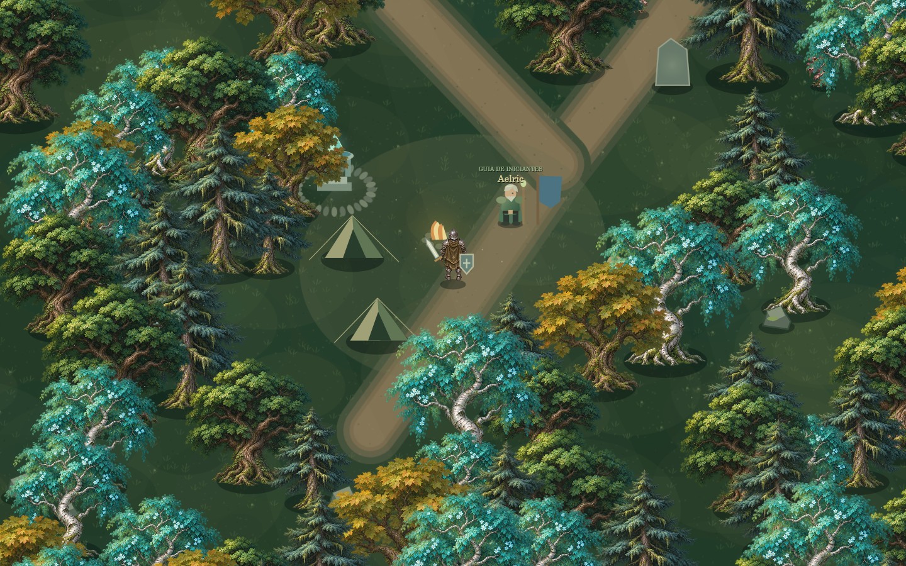

# Mythos Online — O Primeiro Juramento

Protótipo **offline em JavaScript** da primeira área, o **Bosque da Aurora**, com
o **Guardião** como personagem jogável. Windows e macOS, no navegador do desktop.

## Baixar e jogar

1. Baixe [Mythos_Online_Offline_v0.1.zip](Mythos_Online_Offline_v0.1.zip).
2. Extraia o ZIP.
3. Abra **Mythos_Online_Offline_v0.1.html** com dois cliques.

No GitHub, use **Download raw file** para salvar o arquivo. O jogo funciona sem
internet, servidor, Java ou Node.js instalado. O HTML contém todos os assets e códigos.
Também é possível baixar apenas [o HTML autossuficiente](Mythos_Online_Offline_v0.1.html).

## O que você pode analisar

- Uma floresta com clareira segura, trilhas, rio, ponte, santuário, cristais e ruínas.
- Aelric, guia dos iniciantes, com uma jornada que apresenta as mecânicas.
- Três famílias de criaturas comuns e o chefe Cerne Corrompido.
- Espada e escudo, ataque direcional, esquiva, Golpe Frontal e Postura de Bastião.
- Níveis, atributos, recorte da árvore de talentos, mochila, poções e saque.
- Equipamentos que alteram a aparência do Guardião.
- Salvamento local, exportação/importação da jornada e ferramentas de análise.

**WASD** move, **mouse esquerdo** ataca, **Q** esquiva, **F** interage,
**1/2** usam técnicas aprendidas, **F1/F2** usam poções. **C/I/T/M** abrem
personagem, mochila, árvore e mapa. **Esc** abre opções e ferramentas de teste.

Comece conversando com Aelric, junto à bandeira azul ao norte da posição inicial.
Distribua os cinco pontos iniciais em **C**. No nível 5, o guia ensina Golpe Frontal.

## Salvar e continuar

O personagem fica salvo neste navegador. Use **Esc > Exportar jornada** para
guardar um JSON ou levar o progresso para outro computador. O guia completo de uso
está em [LEIA-ME.txt](LEIA-ME.txt). Esta versão ainda não tem multiplayer ou contas.

A proposta para o servidor autoritativo, PostgreSQL, clientes Java/JavaScript,
persistência e proteção contra duplicação está em [ARQUITETURA.md](ARQUITETURA.md).

## Fonte e validação

```sh
node --test tests/core.test.js
node tests/simulation.test.js
python build.py
```

Esses comandos são para desenvolvimento; o jogador só precisa do HTML.
Consulte [VALIDACAO.md](VALIDACAO.md) para os testes realizados e limites de verificação.
Parâmetros desta área continuam abertos a balanceamento, conforme [CHANGELOG.md](CHANGELOG.md).



A imagem acima é uma captura do renderizador Canvas em teste nativo, sem a interface
HTML. O mapa e os personagens são renderizados pelo próprio código do protótipo.
